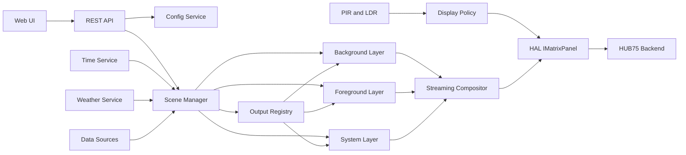
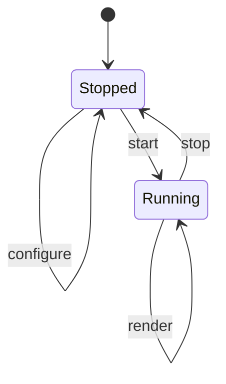

# MegaPanel — ESP32 LED Matrix Application Architecture and Porting Plan

Working name: **MegaPanel**. The name can change; the architecture does not depend on it.

## 1. Purpose and outcome

Build one maintainable ESP32-Arduino application for HUB75 LED matrix panels that:

- runs on multiple logical resolutions, initially **64x64**, **78x78**, **128x64**, and with a clear path to 128x128 and 64x32;
- uses **GFX_Lite / GFX_Layer** as the framebuffer and drawing surface;
- has a **HAL** that the hardware backend implements, so panel wiring, chaining, rotation and driver differences never leak into outputs;
- composes exactly **three drawable pixel layers**: background, foreground and system;
- starts and stops every output at runtime; all output classes are compiled in and pre-instantiated at boot, while memory needed by the active output is reserved in `start()` and freed in `stop()`;
- exposes a modern **web configuration UI** backed by an **ArduinoJson REST API**;
- has working placeholders and policy for a **PIR sensor** and an **LDR/luminosity sensor**;
- ports the best patterns, clocks, animations and media from the four existing projects, rewritten where the old architecture prevents safe reuse.

Audio input and audio-driven visualisers are deliberately out of scope for this revision. The animatedpixelclock `viz` sources remain reference material only.

The result should be a platform, not another monolithic sketch. Adding a clock or effect should mean adding one output class plus one registry entry, with no edits to the render loop, web server or HAL.

---

## 2. Assessment of the existing projects

### 2.1 `clockwise2`

**Strengths**

- The `IClockface` lifecycle in `firmware/lib/cw-commons/IClockface.h` is the right seed: `setup`, `update`, `cleanup`.
- Clock faces are independent and already draw through `GFX_Layer`.
- `cw-gfx-engine` contains useful sprite, tile, object and event primitives for the Mario face.
- It contains a working LDR auto-brightness implementation and a simple NetWizard/OTA setup.
- `Clockface7_Canvas` shows a useful data-driven scene format: JSON describes sprites, text and movement.

**Problems**

- Everything is hard-coded for 64x64.
- Only one foreground layer exists; there is no background or system layer.
- Clock faces obtain the display through the global `Locator` singleton, which hides dependencies and prevents multiple instances.
- Cleanup is inconsistent: Mario does not clear all pointers; Pac-Man allocates inside `drawMap()` and can leak across resets.
- Configuration is flat key/value preferences; the web page is header-driven rather than a JSON API.
- No PIR, scheduling, scene management or output catalog.
- `IClockface` uses `std::string` and `std::vector` in a way that is fine on ESP32 but should be replaced with fixed buffers in hot paths.

**Reuse**

- Lifecycle concept becomes `IOutput::begin/end/render`.
- Clock face implementations become port sources.
- The LDR logic becomes `LightSensorService` + `DisplayPolicy`.
- The canvas JSON format informs a future `media.canvas` output.
- `StatusController` informs the boot/status overlays.

### 2.2 `oled_morphing_clock`

**Strengths**

- The point-set morph is elegant and visually strong: glyphs are reduced to lit pixels, corresponding points are interpolated, and differing point counts are resampled by index.
- Memory use is tiny because one digit buffer is reused.
- It works with packed 1bpp fonts, which are cheap in flash.
- The algorithm is resolution-independent if glyph points are scaled to a target box.

**Problems**

- Procedural, global and blocking (`while (millis() - morphStart < 10) {}`).
- Fixed for a 128x64 OLED and a 15x32 digit cell.
- The packed font parser assumes a fixed record size and does not robustly validate the font header; the per-glyph width prefix is present but not consistently used.
- No colour, no time service, no scene lifecycle.
- Not safe to reuse as-is in a 60 Hz cooperative render loop.

**Reuse**

- The morph algorithm becomes `GlyphMorphEngine`.
- Replace the OLED-specific drawing with a generic glyph source:
  - `GfxFontGlyphSource` for any `GFXfont`;
  - `Packed1bppGlyphSource` for the two OLED fonts;
  - later `BitmapGlyphSource` for custom fonts.
- Precompute the 10 digits and colon once in `begin`, then morph between cached point sets without per-frame allocation.
- Make the animation delta-time based, with configurable duration, easing and direction.

### 2.3 `reference/animatedpixelclock`

**Strengths**

- The richest feature set: 15 clock styles, ambient effects, weather, world clock, audio visualiser (reference only, not ported), notifications, Lua effects, 3D, fonts and a large web portal.
- Good adaptive refresh-rate logic and a clear render tick.
- Notify overlay and system corners are already conceptually overlays.
- Weather is keyless via Open-Meteo.
- The Lua module is well documented and deliberately isolated behind a build flag.
- The docs include measured performance and memory numbers that are useful budgets.

**Problems**

- Monolithic `main.cpp` and a 3091-line `web.cpp`.
- A single giant `Settings` struct and global state for every clock.
- 128x64 is hard-coded in many places: `SCREEN_WIDTH`, `DIGIT_X`, fixed lane/position tables, `wow::kW/kH`, the Lua canvas, and weather layout constants.
- Clocks draw directly to one global `display`; there is no layer abstraction.
- Many clocks are state machines with globals; they cannot be started and stopped cleanly, and their buffers cannot be released independently.
- Several modules referenced by `main.cpp` are absent from this folder (cards, flightboard, railboard, market, yacht radar, climate, presence, audio, metrics, control). They must not be promised as part of the port.
- Web assets are embedded gzip blobs generated by an external script, and route handling is tightly coupled to the app.

**Reuse**

- Algorithms and assets: clocks, ambient effects, weather icons, notify icons, fonts and the world map.
- Ideas: adaptive refresh, scheduled dim/off, notification banner, status corners, playlist/carousel, API-first portal.
- Lua is valuable but must remain optional, size-aware and behind a feature flag. The 3D
  (`fx3d`) module is out of scope for this revision.
- The measured memory/performance notes become acceptance budgets.

### 2.4 `RetroPanel_esp32`

**Strengths**

- The `Drawable` base class is a useful early attempt at a uniform pattern lifecycle.
- Has a real pattern catalog idea and a `start/stop/draw` model.
- Contains useful GIF and JPEG decoding experiments and a Parola-style scrolling ticker concept.
- Has a remote data-provider concept for crypto, stocks, news and weather.
- Has a crude but complete web configuration flow and EEPROM persistence.

**Problems**

- Incomplete: `loop()` is effectively empty and many patterns are commented out.
- `Layer` is an external FastLED-style layer with direct `pixels->data` access, not GFX_Layer. Several patterns reach into that internal buffer.
- EEPROM raw structs with manual offsets are fragile and not versioned safely.
- Patterns use globals, fixed 64x32 or 64x64 dimensions, and have destructor/memory bugs.
- The data provider depends on an external IoT proxy and bespoke streaming parsers.
- The web UI is form-based, has no JSON API, and duplicates configuration logic.
- Several patterns are duplicates or incomplete.

**Reuse**

- Pattern algorithms are useful, but their drawing calls must be rewritten to `PixelCanvas`/GFX_Layer and CRGB.
- `Drawable` informs the `IOutput` lifecycle.
- GIF/JPEG decoders are reference material for `media.image`.
- Ticker and data-provider concepts become `media.ticker` and `DataSourceService`.
- The startup logo and WiFi status screens become system outputs.

### 2.5 `reference/GFX_Lite`

**Strengths**

- Adafruit-GFX-style primitives with native `CRGB` and FastLED-derived colour utilities.
- `GFX_Layer` provides a contiguous framebuffer, layer alpha, colour-key transparency, scrolling, blur, gamma and `present()`.
- `GFX_LayerCompositor` provides a reference alpha/colour-key compositor.
- PSRAM allocation is supported through `GFX_LAYER_PSRAM`.
- No display transport is baked in, which is exactly what the HAL needs.

**Limitations to handle in the new project**

- No per-pixel alpha. Transparency is global layer alpha plus one colour key.
- No `drawFastHLine` / `drawFastVLine`.
- No `textWidth()` helper (can be derived from `getTextBounds`).
- No UTF-8 text layer; the animatedpixelclock `SysTextGfx` is tied to Adafruit GFX internals and RGB565.
- No image scaling/resampling.
- `GFX_LITE_MAX_LAYER_MEMORY` caps layer size.
- The compositor writes to a destination layer, which would be a fourth full buffer if used naively.

**Decision**

Use GFX_Lite and `GFX_Layer` unchanged as the pixel storage and drawing core. Add a thin `PixelCanvas : public GFX_Layer` for line/text helpers, and implement a **streaming compositor** that reads the three layers and writes directly into the HAL output buffer. This keeps the user-visible model at exactly three drawable layers.

---

## 3. Non-negotiable design rules

1. **No output knows the panel wiring, panel count, rotation or DMA details.** It receives a `PixelCanvas` of logical size.
2. **No output owns a global framebuffer.** It draws into the layer passed to it.
3. **All per-output memory is reserved in `start()` and freed in `stop()`.** No per-frame `new`, `malloc` or `String` growth in the render path.
4. **No `delay()` in the render path.** Time is passed in via `FrameContext`.
5. **No hard-coded 64 or 128 in output logic.** Dimensions come from `ScreenSpec` and `Layout`.
6. **At least one output must be running.** If a requested output cannot start on the current resolution, fall back to the next compatible default and report it.
7. **The web server never renders.** It mutates configuration/scene state; the render loop applies it.
8. **Optional features are compile-time flags and runtime-allocated.** Lua, media decoders and data sources can each be removed from a build.
9. **Version the configuration.** Every persisted schema has a version and a migration path.
10. **Keep licences and attribution** for Aurora, FastLED, Adafruit GFX, Lua and any ported sprite data.
11. **Output classes are statically instantiated.** Constructors do no heavy allocation; ownership of runtime buffers belongs to `start()`/`stop()`.

---

## 4. High-level architecture



### Runtime roles

- **App**: boot sequence, service construction, loop order, watchdog.
- **SceneManager**: holds pointers to the pre-instantiated background/foreground/system outputs, starts and stops them, runs the playlist, chooses target FPS, triggers render and composition.
- **OutputRegistry**: static catalog of pre-instantiated output objects, their metadata and config schema. It never constructs outputs on demand.
- **Services**: time, config, network/web, weather, data, storage, sensors, notifications, diagnostics.
- **HAL**: one `IMatrixPanel` implementation for the actual hardware.
- **Outputs**: clocks, patterns, media and system overlays.

---

## 5. Three layers and compositing

### 5.1 Layer responsibilities

| Layer | Purpose | Typical content | Default transparency |
|---|---|---|---|
| Background | Atmosphere and motion behind the main content | stars, plasma, rain, matrix, fire, waves, invaders, custom PCA, Lua background | Opaque, cleared to black |
| Foreground | The main thing being shown | clocks, morphing digits, weather, ticker, media, world clock, Canvas scenes | Black is transparent |
| System | Overlays that must survive output switches | notifications, WiFi/status corners, boot splash, OTA progress, errors, messages | Colour key, black is drawable |

The foreground may be empty. The background may be empty. The system layer is always composed last.

### 5.2 Layer style

```cpp
enum class LayerTransparency : uint8_t {
  Opaque,            // every pixel is drawn
  BlackIsTransparent // legacy-friendly: CRGB::Black means "show what is below"
  ColorKey           // one configured colour is transparent; black is drawable
};

struct LayerStyle {
  bool enabled;
  uint8_t alpha;                 // 0..255, global layer opacity
  LayerTransparency transparency;
  CRGB colorKey;                 // used by ColorKey
  bool dimWhenCovered;           // background dims when foreground is present
};
```

- The background uses `Opaque`.
- The foreground defaults to `BlackIsTransparent` so ported clocks that `fillScreen(0)` still let a starfield show through.
- The system layer uses `ColorKey` with a reserved key such as `CRGB(1, 0, 1)`. It is cleared to the key each frame. Black is then available as an opaque banner colour.
- `clearTransparent()` is a `PixelCanvas` helper: fills with the key in `ColorKey` mode, or with black in `BlackIsTransparent` mode.

### 5.3 Streaming compositor

`SceneCompositor` writes directly into the HAL output buffer:

```cpp
void SceneCompositor::compose(
    const PixelCanvas& background,
    const PixelCanvas* foreground,
    const PixelCanvas* system,
    const LayerStyle& bgStyle,
    const LayerStyle& fgStyle,
    const LayerStyle& sysStyle,
    CRGB* out);
```

Algorithm per pixel:

1. Start with the background colour, scaled by background alpha.
2. If foreground is enabled and the pixel is not transparent, blend it over the result using foreground alpha.
3. If system is enabled and the pixel is not transparent, blend it over the result using system alpha.
4. Apply an optional global software dim, then write to the HAL buffer.

`BlackIsTransparent` is handled by this compositor, not by `GFX_Layer::isTransparent()`, because GFX_Layer only knows one transparency mode. `ColorKey` can use `GFX_Layer::isTransparent()`.

`GFX_LayerCompositor` remains useful as a reference and for tests, but the production path is streaming so there is no fourth drawable layer. If a future backend requires a full composed buffer anyway, that buffer belongs to the HAL, not to the scene model.

### 5.4 Fades and scene transitions

- Scene changes are instant by default, with a single black frame to avoid stale DMA content.
- Optional crossfade: animate the outgoing layer's alpha down and the incoming layer's alpha up over 150–300 ms. This is a `SceneManager` feature and does not complicate outputs.

---

## 6. Output model, categories and lifecycle

### 6.1 Categories

```cpp
enum class OutputCategory : uint8_t {
  BackgroundPattern, // designed to run behind something
  ForegroundPattern, // effects that want the main layer
  DisplayOutput,     // a complete screen: clock, weather, media, data
  SystemOverlay      // notification, status, boot, error
};
```

A single output can declare that it is allowed on more than one layer:

```cpp
enum LayerBits : uint8_t {
  LAYER_BG  = 1 << 0,
  LAYER_FG  = 1 << 1,
  LAYER_SYS = 1 << 2
};
```

- `category` is the primary catalog grouping.
- `allowedLayers` is the hard constraint.
- `defaultLayer` is what the UI preselects.

Examples:

- Starfield: `BackgroundPattern`, allowed BG or FG, default BG.
- Matrix rain: `BackgroundPattern`, allowed BG or FG, default BG.
- Visualiser: `ForegroundPattern`, allowed FG, default FG.
- Clock: `DisplayOutput`, allowed FG, default FG.
- Notification: `SystemOverlay`, allowed SYS, default SYS.

### 6.2 Metadata

```cpp
struct OutputMeta {
  const char* id;              // stable, e.g. "clock.morph"
  const char* name;            // human name
  const char* version;         // port version
  const char* author;          // attribution
  OutputCategory category;
  uint8_t allowedLayers;
  LayerId defaultLayer;
  ScreenSpec designSize;       // 0,0 means resolution-agnostic
  ScreenSpec minSize;          // 0,0 means no minimum
  uint16_t maxWidth;           // 0 means no maximum
  uint16_t maxHeight;
  uint8_t defaultFps;
  uint16_t defaultDwellSec;
  bool animated;
  bool needsTime;
  bool needsNetwork;
  bool needsWeather;
  bool needsFilesystem;
  bool optionalFeature;
};
```

The web catalog is generated from these records plus each output's JSON config schema.

### 6.3 Interface

```cpp
class IOutput {
public:
  virtual ~IOutput() = default;

  virtual const OutputMeta& meta() const = 0;

  // Stores the screen and configuration. Called while the output is stopped;
  // it performs no heavy allocation.
  virtual bool configure(const ScreenSpec& screen,
                         JsonObjectConst config) = 0;

  // Reserves every buffer this output needs. Called when the output is selected.
  virtual bool start(OutputContext& ctx) = 0;

  // Frees everything reserved by start() and returns to a clean stopped state.
  virtual void stop() = 0;

  virtual void render(PixelCanvas& target,
                      const FrameContext& frame) = 0;

  // Live-safe settings only (colour, speed, opacity). Structural changes go
  // through stop(), configure() and start().
  virtual void onConfigChanged(JsonObjectConst config) {}

  virtual void buildConfigSchema(JsonObject& out) const = 0;
  virtual void writeConfig(JsonObject& out) const = 0;

  virtual bool isAnimated() const { return meta().animated; }
  virtual uint8_t preferredFps() const { return meta().defaultFps; }
  virtual bool wantsFullClear() const { return true; }
};
```

### 6.4 Context objects

```cpp
struct OutputContext {
  TimeService& time;
  WeatherService& weather;
  DataService& data;
  StorageService& storage;
  NotificationService& notifications;
  DiagnosticsService& diagnostics;
  ConfigService& config;
  Logger& log;
};

struct FrameContext {
  uint32_t nowMs;
  uint32_t deltaMs;
  float deltaSec;
  uint32_t frameIndex;
  ScreenSpec screen;
  struct tm localTime;
  int64_t epoch;
  bool timeValid;
  bool ntpSynced;
  bool use24Hour;
  uint8_t dateFormat;
  const WeatherData* weather;
  uint8_t luxPercent;
  bool presence;
};
```

Outputs never touch the web server or panel directly.

### 6.5 Registry and runtime resource ownership

There is no dynamic library loading. Every output class is compiled into the firmware and instantiated once at boot. The registry is a static table of pointers to those instances, plus their metadata and schema function. What is dynamic is resource ownership: selecting an output calls `configure()` if needed and then `start()`; leaving it calls `stop()`.

- output constructors are trivial and allocate nothing;
- `configure()` stores the screen spec and configuration only;
- `start()` reserves every buffer the output needs, using `std::unique_ptr`, reserved `std::vector` storage or a PSRAM allocator;
- `stop()` frees every buffer and returns the output to a clean stopped state;
- `SceneManager` never destroys or reconstructs the output object, so repeated switching cannot fragment class-sized allocations;
- a failed `start()` calls `stop()` for cleanup and then falls back to a compatible output.

```cpp
class OutputRegistry {
public:
  static const OutputRegistry& instance();
  IOutput* find(const char* id) const;
  size_t count() const;
  const OutputDescriptor& at(size_t index) const;
};
```

`OutputDescriptor` holds an `IOutput*` instance, a `const OutputMeta& (*meta)()` accessor and a `void (*schema)(JsonObject&)` function. An explicit table in one file is easier to audit than a registration macro and avoids static-initialisation order problems.

```cpp
static ClockStandard    gClockStandard;
static ClockLarge       gClockLarge;
static ClockMorphDigits gClockMorphDigits;
static StatusCorners    gStatusCorners;

static const OutputDescriptor kOutputs[] = {
  {&gClockStandard,    &ClockStandard::metaStatic,    &ClockStandard::schemaStatic},
  {&gClockLarge,       &ClockLarge::metaStatic,       &ClockLarge::schemaStatic},
  {&gClockMorphDigits, &ClockMorphDigits::metaStatic, &ClockMorphDigits::schemaStatic},
  {&gStatusCorners,    &StatusCorners::metaStatic,    &StatusCorners::schemaStatic},
};
```

Each output's constructor is empty or trivial. Its `start()` is the only place where it creates buffers; its `stop()` is the only place where it releases them.



The output object lives for the whole firmware lifetime. Only its runtime buffers are reserved and released.

### 6.6 Scene manager

```cpp
struct SceneSpec {
  char backgroundId[32];
  char foregroundId[32];
  LayerStyle background;
  LayerStyle foreground;
  LayerStyle system;
  bool systemStatusCorners;
  bool systemNotifications;
  uint16_t transitionMs;
};

struct PlaylistItem {
  char backgroundId[32];
  char foregroundId[32];
  uint16_t seconds;
};

struct Playlist {
  bool enabled;
  uint16_t idleSeconds;
  std::vector<PlaylistItem> items;
};
```

`SceneManager` responsibilities:

- Hold `IOutput* background_`, `IOutput* foreground_`, and a fixed-size array of `IOutput*` system overlays. The outputs are owned by the registry, not by `SceneManager`.
- Switch by calling `stop()` on the old instance and `start()` on the new one; never destroy or reconstruct the class.
- Call `configure()` while the output is stopped, and `onConfigChanged()` only for live-safe fields while it is running.
- Validate layer permissions and resolution compatibility before switching.
- If `start()` fails, log the reason, call `stop()` for cleanup, and fall back to the next compatible default.
- Run the playlist only after the configured idle period.
- Compute target FPS as the maximum of active outputs' preferred FPS, capped by configuration, with a floor for static content and a boost to 60 while a notification scrolls.
- Call `render()` and `SceneCompositor::compose()` on frame deadlines.
- Expose the current state to the web API.

### 6.7 Render order

Every frame:

1. If the background is animated or marked dirty, clear it (or let the output fully repaint).
2. Clear foreground to its transparent value unless the output promises a full repaint.
3. Clear system to its key if any system overlay is active.
4. Render background, foreground, then system overlays.
5. Compose into the HAL framebuffer.
6. `panel.show()`.
7. Update diagnostics.

Static outputs can return without redrawing; the compositor still runs because another layer may have changed.

---

## 7. Resolution and layout strategy

### 7.1 The problem

The reference projects are not resolution-independent:

- `clockwise2` is 64x64.
- `oled_morphing_clock` is a 15x32 digit on a 128x64 OLED.
- `animatedpixelclock` is 128x64 with many fixed positions and a 5-digit row at 18 px per digit.
- `RetroPanel` is mostly 64x32/64x64 and reaches into a FastLED buffer.

A naive stretch to 64x64 destroys readability and animation geometry. A naive letterbox of 128x64 into 64x64 leaves a 64x32 strip. Therefore the platform needs **layout strategies**, not a single scaling rule.

### 7.2 Layout primitives

```cpp
struct Rect { int16_t x, y, w, h; };

class Layout {
public:
  ScreenSpec screen;
  Rect safe;                  // screen minus configurable margin
  int16_t unit(int16_t n) const;   // n scaled from a 64 px reference
  Rect centered(int16_t w, int16_t h) const;
  Rect inset(int16_t px) const;
  int16_t alignX(int16_t contentW) const;
  int16_t alignY(int16_t contentH) const;
};
```

- `unit(n)` uses `min(width, height) / 64` for proportional spacing.
- `safe` defaults to a 1–2 px inset so effects do not touch the panel edge.
- Outputs use `screen` and `safe` instead of constants.

### 7.3 Clock layout engine

Clocks need a dedicated layout, not a generic bitmap scale.

```cpp
enum class ClockArrangement : uint8_t {
  FiveAcross,   // H H : M M
  TwoRows,      // HH over MM
  TwoByTwo,     // HH / MM stacked as 2x2 digits
  SingleRow,    // compressed HH:MM
  Custom
};

struct ClockLayout {
  ClockArrangement arrangement;
  Rect time;
  Rect digits[5];       // 0,1 = hour; 2 = colon; 3,4 = minute
  Rect date;
  Rect playArea;        // for sprites and physics
  int16_t groundY;
  int16_t patrolY;
  uint8_t digitW, digitH;
  uint8_t gap;
  uint8_t textSize;
  const GFXfont* font;
};
```

`ClockLayout::choose(screen, fontMetrics, config)` evaluates arrangements in order and picks the first that fits with a minimum legibility threshold:

- 128x64: `FiveAcross` with a date row.
- 78x78: `TwoRows`, with a larger digit box, or `FiveAcross` with a smaller font.
- 64x64: `TwoByTwo` or `TwoRows`; date optional.
- 64x32: `SingleRow` with a small font; many outputs declare 64x32 unsupported.

The `playArea`, `groundY` and `patrolY` are what allow Mario, Pac-Man, Snake, Tetris, Asteroids, Dino and TRON to adapt without each inventing its own geometry.

### 7.4 Compatibility labels

Every output declares one of:

| Label | Meaning |
|---|---|
| `Any` | Procedural; works at any reasonable size |
| `Native64` | Designed for 64x64; small adaptation for 78x78/128x64 |
| `Native128` | Designed for 128x64; needs a compact layout for 64x64 |
| `Scaled` | Can render in a virtual design canvas and be fitted |
| `RequiresRedesign` | Fixed geometry; 64x64 needs a dedicated compact layout |
| `Optional` | Large dependency or low priority |

The web UI displays these labels and warns when an output is being used below its best size.

### 7.5 Scaling modes for non-procedural content

For media and virtual canvases:

- `Fit`: preserve aspect ratio, letterbox with a configured background.
- `Fill`: preserve aspect ratio, crop.
- `Stretch`: ignore aspect ratio.
- `Integer`: integer nearest-neighbour scale, best for pixel art.
- `Center`: no scaling, center; clip if larger.

These are implemented once in `PixelCanvas`/`ImageUtils`, not in every output.

### 7.6 Specific recommendations

- **Clocks**: use `ClockLayout`, not bitmap scaling.
- **Procedural backgrounds**: use `screen` and normalized coordinates.
- **Sprite clocks**: use `ClockLayout` geometry and scale sprites by `unit()` with a minimum of 1.
- **Weather / Bomberman / Tetris / TRON / World clock**: build a compact layout for 64x64 where practical; otherwise run in a 128x64 virtual canvas with `Fit` and mark as “best at 128x64”.
- **Lua**: runs in a 128x64 virtual canvas initially, then exposes `width`/`height` to scripts in a later phase.
- **Media**: always use explicit scaling mode and a background colour; no assumptions about native size.

---

## 8. HAL

### 8.1 Interface

```cpp
struct PanelPinMap {
  int8_t r1, g1, b1, r2, g2, b2;
  int8_t a, b, c, d, e;
  int8_t lat, oe, clk;
};

struct PanelConfig {
  ScreenSpec logical;       // e.g. 128x64
  uint16_t panelW, panelH;  // e.g. 64x64
  uint8_t rows, cols;       // e.g. 1x2
  uint8_t chainType;        // library enum or custom
  uint8_t rotation;         // 0..3
  PanelPinMap pins;
  uint8_t driver;           // FM6126A, etc.
  bool clkPhase;
  bool doubleBuffer;
  bool swapBlueGreen;
  uint8_t brightness;
};

class IMatrixPanel {
public:
  virtual ~IMatrixPanel() = default;

  virtual bool begin(const PanelConfig& config) = 0;
  virtual void end() = 0;
  virtual bool ready() const = 0;

  virtual ScreenSpec size() const = 0;
  virtual CRGB* framebuffer() = 0;   // logical W*H, owned by HAL
  virtual void show() = 0;           // push/flip to hardware
  virtual void waitForScan() {}

  virtual void setBrightness(uint8_t value) = 0;
  virtual uint8_t brightness() const = 0;

  virtual const char* backendName() const = 0;
};
```

### 8.2 Reference backend: `Hub75DmaPanel`

- Uses `ESP32-HUB75-MatrixPanel-I2S-DMA` with `NO_GFX=1` so it does not pull a second GFX class.
- Supports a single panel and chained panels through `VirtualMatrixPanel` or a logical-to-physical index table.
- Allocates the logical `CRGB` framebuffer in PSRAM for sizes above 64x64, internal SRAM otherwise.
- Builds a `uint32_t index[W*H]` mapping logical coordinates to the DMA back-buffer offset at `begin()`. This handles row/column chaining, serpentine order, rotation and panel drivers without per-pixel branching in the render loop.
- `show()` copies the logical framebuffer through the index table into the library back buffer and flips. If the library exposes a contiguous RGB888 back buffer with matching layout, use a row `memcpy` fast path.
- `setBrightness()` calls the library's `setBrightness8()`.
- DMA buffers stay in internal SRAM. Do not move the DMA buffer to PSRAM; the reference notes stripes, flicker and TLS failures when that was tried.
- Hardware-specific defaults such as `FM6126A`, `clkphase=false` and double buffering are configuration, not constants buried in outputs.

### 8.3 Other backends

- `NullPanel`: host/testing; stores the framebuffer and can write a PPM/BMP snapshot.
- `Hub75EspIdfPanel`: placeholder for a future IDF driver.
- Any other backend: implement `IMatrixPanel`; no output changes.

### 8.4 Panel self-test

On boot, if configured:

1. Fill red, green, blue and white for a short period.
2. Draw a border and corner markers.
3. Draw the configured resolution and backend name.
4. Then start the boot splash.

This catches wrong wiring, chain order, rotation and color order immediately.

---

## 9. Runtime services

### 9.1 TimeService

- SNTP through the ESP32 native `configTzTime()` / `sntp`.
- POSIX timezone strings, with DST handled by `tzset`.
- Optional timezone index/name for the UI; ship a compact table derived from `animatedpixelclock/timezones.cpp` if needed.
- Manual time and manual POSIX string for offline use.
- `FrameContext` carries `struct tm`, epoch and validity.
- Formatting helpers for 12/24 hour, date formats and colon blink.
- No dependency on `ezTime`; this removes a library and keeps time behaviour explicit.

### 9.2 ConfigService

- Core settings typed in C++ and stored in NVS namespace `panel`.
- Per-output settings stored as JSON strings under keys such as `o_clock_morph`, using ArduinoJson.
- One `schemaVersion` key with migrations.
- Debounced writes: mark dirty, write after 1.5 s of no changes.
- Validation and clamping on load and on API write.
- Export/import as one JSON document; secrets redacted unless authenticated.
- Factory reset clears the panel namespace but leaves WiFi credentials unless explicitly requested.

### 9.3 NetworkService

- WiFiManager AP portal for first boot and reconfiguration; no second provisioning library.
- Optional static IP, DNS and mDNS.
- Reconnect watchdog.
- OTA through the Arduino `Update` API with a guarded `/api/ota` route; optional ElegantOTA later if desired.
- WiFi sleep disabled while serving large web assets.

### 9.4 WebServerService

- Synchronous `WebServer` in `loop()` for predictable concurrency.
- Static UI from LittleFS with gzip and cache headers; embedded minimal fallback if the filesystem is missing.
- ArduinoJson v7 for all API input/output.
- JSON documents allocated from PSRAM when available.
- Upload size limits, safe path validation and host/origin checks for write routes.
- Optional HTTP Basic auth for writes and OTA.

### 9.5 BrightnessService / DisplayPolicy

Inputs:

- manual brightness;
- LDR auto-brightness;
- scheduled dim and scheduled off windows;
- PIR absence policy;
- runtime forced off.

Priority, highest first:

1. PIR absent with `blank` policy → 0.
2. Scheduled off → 0.
3. Runtime forced off → 0.
4. Scheduled dim → dim level.
5. LDR auto → mapped brightness between configured min and max.
6. Manual brightness.

Details:

- Apply only when the target changes by at least 2 levels; smooth large changes over 250 ms if desired.
- A zero persisted brightness is clamped to 1 so a bad config cannot brick the display; runtime off is separate.
- Expose the resolved target and the reason in `/api/status`.

### 9.6 PresenceService (PIR placeholder)

```cpp
struct PresenceConfig {
  bool enabled;
  int8_t pin;              // -1 = disabled
  bool activeHigh;
  uint16_t debounceMs;
  uint16_t timeoutSec;     // no motion before absent
  uint8_t absentAction;    // 0 = blank, 1 = dim, 2 = ambient background
  uint8_t absentDim;       // brightness when dim
  bool wakeOnMotion;
};
```

- Poll the pin every 50 ms; PIR sensors hold their output for seconds, so an ISR is unnecessary.
- Track `lastMotionMs`, `present`, `absent`.
- Expose raw and debounced state to diagnostics and the web UI.
- `absentAction=ambient` can switch the foreground off and leave a background pattern running; `blank` drives brightness to zero.
- All methods have safe no-sensor stubs.

### 9.7 LightSensorService (LDR placeholder)

```cpp
struct LightConfig {
  bool enabled;
  int8_t pin;              // ADC1 pin on ESP32
  uint16_t sampleIntervalMs;
  uint16_t rawDark;        // calibration
  uint16_t rawBright;
  bool invert;
  uint8_t minBrightness;
  uint8_t maxBrightness;
  uint8_t smoothing;       // 0..100
};
```

- Configure ADC resolution and attenuation explicitly.
- Median of 5 samples; update every 500 ms by default.
- Map raw to a 0–100 lux estimate with calibration and inversion.
- Apply hysteresis so the panel does not flicker at a threshold.
- Provide a “calibrate” API that samples the current raw value as dark or bright.
- `BrightnessService` consumes the calibrated percentage; outputs never read the ADC.

### 9.8 WeatherService

- Port the keyless Open-Meteo client from animatedpixelclock.
- One background task or a non-blocking state machine; never block the render loop.
- Publish an immutable `WeatherData` snapshot with a sequence number.
- Cache the last successful result in NVS or LittleFS and show staleness.
- Units, location and enable/disable in config.
- Weather icons from animatedpixelclock and RetroPanel.

### 9.9 DataService

- A generic configurable source abstraction:

```cpp
class IDataSource {
public:
  virtual bool begin(JsonObjectConst config) = 0;
  virtual void end() = 0;
  virtual void loop(uint32_t nowMs) = 0;
  virtual bool hasData() const = 0;
  virtual const DataSnapshot& snapshot() const = 0;
};
```

- Built-in sources: Open-Meteo weather, a generic HTTP JSON source with JSONPath-like field mapping, and optional crypto/stock/news sources.
- Replace RetroPanel's hard-coded IoT proxy with configurable URL, headers, refresh interval and field mappings.
- Run network I/O in a worker task or non-blocking client; publish snapshots under a mutex or double-buffer.
- Used by `media.ticker`, `clock.weather`, `media.weather` and future data displays.

### 9.10 StorageService

- LittleFS for `www`, `anim`, `images`, `effects`, `fonts`.
- Safe path checks: no `..`, no absolute paths, restricted extensions, size limits.
- Atomic uploads: write to `.tmp`, validate, rename.
- Free-space reporting for the web UI.

### 9.11 NotificationService

- Queue of notifications with text, icon, colour, duration and position.
- The `/api/notify` route enqueues; the system overlay output renders the active one.
- Scrolling marquee when the text does not fit; dt-based, not frame-count-based.
- Priority: a notification can pre-empt a toast but not OTA/error screens.

### 9.12 DiagnosticsService

- Loop time, frame time, compose time, achieved FPS, dropped frames.
- Internal and PSRAM free/min/largest block.
- Reset reason, uptime, WiFi RSSI, IP, panel refresh rate.
- Active output IDs, scene state, target FPS.
- PIR raw/debounced, LDR raw/percent, resolved brightness and reason.
- Ring-buffer log in PSRAM, readable over `/api/log`.
- Optional serial console: `help`, `outputs`, `scene`, `brightness`, `heap`, `reboot`.

---

## 10. Web configuration and API

### 10.1 UI structure

A single-page application in `data/www/`, no external CDN:

- `index.html` — shell and navigation.
- `app.js` — API client, state, dynamic forms, preview canvas.
- `style.css` — responsive dark theme.
- `icons/` — small SVG icons.

Pages:

1. **Dashboard** — live preview, current background/foreground, FPS, frame time, heap, IP, time, brightness, PIR/LDR state.
2. **Scene** — background and foreground pickers grouped by category, layer alpha sliders, system overlay toggles, playlist editor with reorder and dwell seconds, apply immediately.
3. **Outputs** — catalog grouped by category; selecting an output shows its generated config form, supported sizes and port status. Saves per-output config.
4. **Display** — panel geometry, chain layout, rotation, colour order, driver, brightness, gamma, scheduled dim/off, LDR calibration.
5. **Sensors** — PIR pin/active level/timeout/action; LDR pin/calibration/curve; live readings.
6. **Network & Time** — WiFi scan/connect, static IP, mDNS, NTP servers, timezone, 12/24 hour, date format.
7. **Media** — animations, images, Lua effects, fonts; upload/list/delete/play; free space.
8. **System** — firmware version, build features, reset reason, logs, OTA, export/import config, factory reset, reboot.

### 10.2 Config document

```json
{
  "version": 1,
  "device": { "name": "megapanel" },
  "display": {
    "logicalWidth": 128,
    "logicalHeight": 64,
    "panelWidth": 64,
    "panelHeight": 64,
    "rows": 1,
    "cols": 2,
    "chainType": 0,
    "rotation": 0,
    "brightness": 180,
    "gamma": 2.2,
    "driver": "FM6126A",
    "clkPhase": false
  },
  "time": {
    "posix": "GMT0BST,M3.5.0/01:00,M10.5.0/02:00",
    "ntp1": "pool.ntp.org",
    "ntp2": "time.nist.gov",
    "use24Hour": true,
    "dateFormat": 0
  },
  "brightness": {
    "mode": "manual",
    "manual": 180,
    "schedule": {
      "dimEnabled": false,
      "dimStart": "22:00",
      "dimEnd": "07:00",
      "dimLevel": 40,
      "offEnabled": false,
      "offStart": "00:00",
      "offEnd": "07:00"
    }
  },
  "presence": {
    "enabled": false,
    "pin": -1,
    "activeHigh": true,
    "timeoutSec": 300,
    "absentAction": "blank",
    "absentDim": 8
  },
  "light": {
    "enabled": false,
    "pin": -1,
    "rawDark": 0,
    "rawBright": 4095,
    "minBrightness": 8,
    "maxBrightness": 200
  },
  "scene": {
    "backgroundId": "ambient.stars",
    "foregroundId": "clock.morph",
    "backgroundAlpha": 255,
    "foregroundAlpha": 255,
    "systemAlpha": 255,
    "statusCorners": true,
    "notifications": true,
    "playlist": {
      "enabled": false,
      "idleSeconds": 60,
      "items": []
    }
  },
  "weather": {
    "enabled": false,
    "latitude": 0.0,
    "longitude": 0.0,
    "fahrenheit": false
  },
  "network": {
    "hostname": "megapanel",
    "staticIp": false,
    "ip": "",
    "gateway": "",
    "subnet": "",
    "dns1": "",
    "dns2": ""
  },
  "outputs": {
    "clock.morph": {
      "font": "morph_modern",
      "color": "#FFFFFF",
      "showSeconds": false,
      "morphMs": 320,
      "direction": "forward"
    }
  }
}
```

- The server deep-merges a posted document over the current one, so partial updates are safe.
- Unknown output IDs are rejected or ignored with a warning.
- Every field is validated and clamped in C++.
- `GET /api/config` redacts WiFi passwords and API keys unless the request is authenticated.

### 10.3 Endpoints

| Method | Path | Purpose |
|---|---|---|
| GET | `/` | Web UI |
| GET | `/api/status` | Runtime health, FPS, heap, scene, sensors |
| GET | `/api/outputs` | Output catalog with metadata and config schemas |
| GET | `/api/config` | Full configuration |
| POST | `/api/config` | Deep-merge and apply configuration |
| POST | `/api/config/reset` | Reset to defaults, with confirmation |
| GET | `/api/scene` | Current scene and playlist |
| POST | `/api/scene` | Set background/foreground/overlays/alpha/playlist |
| POST | `/api/display` | On/off and brightness |
| POST | `/api/notify` | Queue a notification |
| GET | `/api/news` | Headlines, staleness and fetch state |
| POST | `/api/news` | Request an immediate news refresh |
| GET | `/api/sensors` | PIR and LDR live values |
| POST | `/api/sensors/calibrate` | Set LDR dark/bright calibration |
| GET | `/api/time` | Current time, timezone and sync status |
| POST | `/api/time` | Timezone, NTP and manual time |
| GET | `/api/preview` | Raw RGB888 preview with `X-Width`, `X-Height`, `X-Frame` |
| GET | `/api/files` | List media/effects/fonts |
| POST | `/api/files/upload` | Multipart upload |
| DELETE | `/api/files` | Delete a file |
| POST | `/api/files/play` | Play an animation or image |
| POST | `/api/ota` | Firmware upload |
| GET | `/api/ota/status` | OTA state |
| GET | `/api/log` | Ring-buffer log |
| POST | `/api/reboot` | Reboot |
| GET | `/api/export` | Export configuration |
| POST | `/api/import` | Import configuration |
| POST | `/api/lua` | Lua effect control, if enabled |

Error shape:

```json
{
  "ok": false,
  "error": {
    "code": "invalid_value",
    "field": "display.brightness",
    "message": "must be 1..255"
  }
}
```

### 10.4 Preview

- `/api/preview` returns the HAL's logical framebuffer as raw RGB888.
- The UI draws it into a `<canvas>` with `ImageData`.
- Throttle to 2–5 fps, only while the page is visible.
- No extra full-screen buffer is required; the HAL framebuffer is the source.

### 10.5 Security

- Optional admin password; when set, all write routes and OTA require HTTP Basic auth.
- Read-only status and preview remain open on the local network.
- Reject writes with a foreign `Host` or `Origin`.
- Validate upload extensions, size and paths.
- Do not expose WiFi passwords or API keys in GET responses.
- Warn in the UI if the AP portal is open.

---

## 11. Output catalog and porting matrix

Compatibility key:

- **A** — any size, procedural.
- **S** — scalable with the layout engine.
- **N64** — native 64x64.
- **N128** — native 128x64, needs a compact layout for smaller screens.
- **L** — virtual 128x64 canvas with fit/letterbox.
- **R** — requires a dedicated redesign for 64x64.
- **O** — optional/later.

### 11.1 Clocks and display outputs

| ID | Source | Category | Layer | 64x64 | 78x78 | 128x64 | Port approach |
|---|---|---|---|---|---|---|---|
| `clock.standard` | animatedpixelclock `clock_common.cpp` | Display | FG | S | S | S | Text clock on `ClockLayout`; date row optional |
| `clock.large` | animatedpixelclock `clock_common.cpp` | Display | FG | S | S | S | Largest arrangement that fits |
| `clock.morph` | oled_morphing_clock | Display | FG | S | S | S | New generic glyph morph engine |
| `clock.words` | clockwise2 `Clockface2_TIW` | Display | FG | N64 | S | S | Width-aware text wrapping; remove hard-coded coordinates |
| `clock.worldmap.cw` | clockwise2 `Clockface3_WorldMap` | Display | FG | N64 | S | S | Map crop/scale; keep 120x56 source |
| `clock.mario.cw` | clockwise2 `Clockface1_Mario` | Display | FG | N64 | S | S | Port sprite engine to `PixelCanvas`; remove Locator |
| `clock.pacman.cw` | clockwise2 `Clockface5_Pacman` | Display | FG | N64 | S | S | Fixed 5 px grid; scale and fix allocation leak |
| `clock.canvas` | clockwise2 `Clockface7_Canvas` | Display | FG | N64 | S | S | JSON sprite scenes; local or HTTP; PNG decode |
| `clock.mario` | animatedpixelclock `clock_mario.cpp` | Display | FG | R | R | N128 | Rich state machine; use `ClockLayout` and compact sprites |
| `clock.space` | animatedpixelclock `clock_space.cpp` | Display | FG | S | S | N128 | Scale sprites and laser bounds |
| `clock.pong` | animatedpixelclock `clock_pong.cpp` | Display | FG | S | S | N128 | Recompute play area, paddle and digit transitions |
| `clock.pacman` | animatedpixelclock `clock_pacman.cpp` | Display | FG | S | S | N128 | Recompute grid and pellet spacing |
| `clock.snake` | animatedpixelclock `clock_snake.cpp` | Display | FG | S | S | N128 | Grid derived from screen and cell size |
| `clock.tetris` | animatedpixelclock `clock_tetris.cpp` | Display | FG | R | R | N128 | Well width from screen; remove 32-bit fixed mask assumption |
| `clock.asteroids` | animatedpixelclock `clock_asteroids.cpp` | Display | FG | A | A | N128 | Fluid positions; already mostly resolution-independent |
| `clock.dino` | animatedpixelclock `clock_dino.cpp` | Display | FG | A | A | N128 | Fluid scroll and ground line |
| `clock.matrix` | animatedpixelclock `clock_matrix.cpp` | Display | FG | A | A | N128 | Column-based; works at any size |
| `clock.weather` | animatedpixelclock `clock_weather.cpp` + `weather_layout.h` | Display | FG | R | R | N128 | Compact icon/temp layout for 64x64 |
| `clock.bomberman` | animatedpixelclock `clock_bomberman.cpp` | Display | FG | R | R | N128 | Fixed lanes; compact redesign needed |
| `clock.tron` | animatedpixelclock `clock_tron.cpp` | Display | FG | S | S | N128 | 64x32 grid scaled 2x on 128x64; recompute for 64x64 |
| `clock.world` | animatedpixelclock `worldclock/` | Display | FG | R | R | N128 | Dotted map needs 128x64 detail; downsample for smaller |
| `clock.cycle` | animatedpixelclock style 9 | — | — | — | — | — | Replaced by the playlist; not an output |

### 11.2 Background and foreground patterns

| ID | Source | Category | Layer | 64x64 | 78x78 | 128x64 | Port approach |
|---|---|---|---|---|---|---|---|
| `ambient.stars` | animatedpixelclock `ambient_stars.cpp` | BG pattern | BG | A | A | A | Rewrite to `PixelCanvas`; normalized star field |
| `ambient.invaders` | animatedpixelclock `ambient_invaders.cpp` | BG pattern | BG | S | S | A | Scale sprites and patrol lanes |
| `ambient.pacman_chase` | animatedpixelclock `ambient_pacman_chase.cpp` | BG pattern | BG | S | S | A | Scale grid and sprites |
| `ambient.custom_pca` | animatedpixelclock `anim_store.cpp` | BG pattern | BG | S | S | S | New PCA header with width/height; fit legacy 128x64 |
| `pattern.starfield` | RetroPanel `PatternStarfield` | BG pattern | BG | A | A | A | Fix double free; use `PixelCanvas` |
| `pattern.plasma` | RetroPanel `PatternPlasma` | BG pattern | BG | A | A | A | Direct port; procedural |
| `pattern.rain` | RetroPanel `PatternRain` | BG pattern | BG | A | A | A | Remove unused buffer; bounds-safe drops |
| `pattern.matrix` | animatedpixelclock `clock_matrix` rain / RetroPanel | BG pattern | BG/FG | A | A | A | Column-based; shared with clock |
| `pattern.fire` | RetroPanel `PatternFireKoz` | BG pattern | BG | A | A | A | Rewrite buffer access; procedural |
| `pattern.wave` | RetroPanel `PatternWave` | BG pattern | BG | A | A | A | Direct port; procedural |
| `pattern.spiro` | RetroPanel `PatternSpiro` | BG pattern | BG | A | A | A | Rewrite `pixels->data` access to `getPixel`/`setPixel` |
| `pattern.mandala` | RetroPanel `PatternElectricMandala` | BG pattern | BG | A | A | A | Rewrite pixel access; keep Aurora attribution |
| `pattern.fireworks` | RetroPanel `PatternFireWorks` | BG pattern | BG | A | A | A | Rewrite `Firework` coordinates and colour calls |
| `pattern.xbm` | RetroPanel `PatternXBMFadeInOut` | BG/system | BG | S | S | S | Scale bitmap; good for splash/logo |
| `pattern.lua` | animatedpixelclock `lua/` | BG/FG pattern | BG/FG | L | L | L | Optional; virtual canvas and `px.w/px.h` |

> Audio-driven visualisers (`viz/*`) are intentionally not ported in this revision. There is no `AudioService` or audio input; the `viz` sources remain reference material only.

### 11.3 Media, data and system outputs

| ID | Source | Category | Layer | 64x64 | 78x78 | 128x64 | Port approach |
|---|---|---|---|---|---|---|---|
| `media.image` | RetroPanel GIF/JPEG + new PNG | Display | FG | S | S | S | Unified decoder and scaling modes |
| `media.pca` | animatedpixelclock `anim_store` | Display/BG | BG/FG | S | S | S | New header with dimensions; legacy fit |
| `media.ticker` | RetroPanel `Display_Ticker` | Display | FG | A | A | A | Text width from `getTextBounds`; data snapshots, `{name}`/`{price}`/`{change}`/`{percent}` tokens, or the joined news feed |
| `media.asset` | new, over `DataService` | Display | FG | S | S | S | Asset name on top, price in the middle, movement in red/green below; one output for every asset class |
| `media.news` | RetroPanel ticker/news handlers, new renderer | Display | FG | S | S | S | Vertically scrolling, word-wrapped headlines from `NewsService`; optional header row |
| `media.weather` | RetroPanel `Display_Weather` | Display | FG | R | R | N128 | Superseded by `clock.weather`; merge icons |
| `media.weather_gif` | RetroPanel `Display_WeatherGIF` | Display | FG | R | R | N128 | Merge into `media.image`/weather |
| `media.canvas` | clockwise2 `Clockface7_Canvas` | Display | FG | N64 | S | S | JSON sprites; local/remote assets |
| `sys.notify` | animatedpixelclock `notify.cpp` | System | SYS | A | A | A | Draw into system layer; marquee |
| `sys.status_corners` | animatedpixelclock `sys_corners.cpp` | System | SYS | A | A | A | WiFi/mode icon; optional |
| `sys.boot_splash` | clockwise2 `StatusController` / RetroPanel logo | System | SYS | S | S | S | Logo scale; network/time status |
| `sys.message` | RetroPanel custom message | System | SYS | A | A | A | Scrolling or static message |
| `sys.ota` | new / `Update` | System | SYS | A | A | A | Progress bar and status |
| `sys.error` | new | System | SYS | A | A | A | Readable error card and log hint |
| `sys.network_setup` | clockwise2/RetroPanel | System | SYS | A | A | A | AP name, IP or QR code |

### 11.4 Data-provider mapping

| Capability | Source | New home |
|---|---|---|
| Weather current and forecast | animatedpixelclock `weather/`; RetroPanel weather handlers | `WeatherService` |
| Crypto and stocks | RetroPanel `DataQuery` + `ajsp` handlers | `DataService` generic HTTP source |
| News headlines | RetroPanel ticker/news handlers | `NewsService` + `media.news` |
| Timezones and POSIX strings | animatedpixelclock `timezones.cpp` | `TimeService` |
| World clock cities and map | animatedpixelclock `worldclock/` | `clock.world` |
| Lua scripts | animatedpixelclock `lua/` | optional `pattern.lua` |

---

## 12. Repository layout

Create the new project at the repository root so it is the default PlatformIO project. The reference folders stay untouched and are not compiled because PlatformIO only compiles `src/` and `lib/`.

```text
platformio.ini
partitions_8mb.csv
partitions_16mb.csv
data/
  www/
    index.html
    app.js
    style.css
    icons/
  anim/
  images/
  effects/
  fonts/
src/
  main.cpp
  app/
    App.hpp / App.cpp
    AppConfig.hpp
    BootSequence.cpp
  core/
    Types.hpp
    IOutput.hpp
    OutputMeta.hpp
    OutputRegistry.hpp / .cpp
    SceneManager.hpp / .cpp
    SceneCompositor.hpp / .cpp
    PixelCanvas.hpp / .cpp
    Layout.hpp / .cpp
    ClockLayout.hpp / .cpp
    FrameScheduler.hpp / .cpp
    EventBus.hpp
  hal/
    IMatrixPanel.hpp
    PanelConfig.hpp
    Hub75DmaPanel.hpp / .cpp
    NullPanel.hpp / .cpp
    PanelFactory.hpp / .cpp
  services/
    TimeService.hpp / .cpp
    ConfigService.hpp / .cpp
    NetworkService.hpp / .cpp
    WebServerService.hpp / .cpp
    ApiRoutes.cpp
    BrightnessService.hpp / .cpp
    PresenceService.hpp / .cpp
    LightSensorService.hpp / .cpp
    WeatherService.hpp / .cpp
    DataService.hpp / .cpp
    StorageService.hpp / .cpp
    NotificationService.hpp / .cpp
    DiagnosticsService.hpp / .cpp
    OTAService.hpp / .cpp
  outputs/
    clocks/
      ClockStandard.cpp
      ClockLarge.cpp
      ClockMorphDigits.cpp
      glyph/
        IGlyphSource.hpp
        GfxFontGlyphSource.cpp
        Packed1bppGlyphSource.cpp
        GlyphMorphEngine.cpp
      ClockWords.cpp
      ClockWorldMapCw.cpp
      ClockMarioCw.cpp
      ClockPacmanCw.cpp
      ClockCanvas.cpp
      ClockMario.cpp
      ClockSpace.cpp
      ClockPong.cpp
      ClockPacman.cpp
      ClockSnake.cpp
      ClockTetris.cpp
      ClockAsteroids.cpp
      ClockDino.cpp
      ClockMatrix.cpp
      ClockWeather.cpp
      ClockBomberman.cpp
      ClockTron.cpp
      ClockWorld.cpp
    ambient/
      AmbientStars.cpp
      AmbientInvaders.cpp
      AmbientPacmanChase.cpp
      AmbientCustomPca.cpp
      PatternPlasma.cpp
      PatternRain.cpp
      PatternMatrix.cpp
      PatternFire.cpp
      PatternWave.cpp
      PatternSpiro.cpp
      PatternMandala.cpp
      PatternFireworks.cpp
      PatternXbm.cpp
    media/
      MediaImage.cpp
      MediaPca.cpp
      TickerOutput.cpp
      CanvasOutput.cpp
    system/
      NotifyOverlay.cpp
      StatusCorners.cpp
      BootSplash.cpp
      MessageOverlay.cpp
      OtaOverlay.cpp
      ErrorOverlay.cpp
    optional/
      lua/
  fonts/
    ...
  util/
    Logger.hpp
    JsonUtil.hpp
    MathUtil.hpp
    ImageUtil.hpp
test/
  native/
    ...
docs/
  ARCHITECTURE.md
  OUTPUTS.md
  WEB_API.md
  PORTING.md
  HARDWARE.md
  TESTING.md
plans/
  panel-architecture.md
```

Keep the reference projects as read-only sources. Do not copy entire old files into `src/` without rewriting their dependencies.

---

## 13. Build, dependencies, memory and performance

### 13.1 PlatformIO environments

- `env:esp32s3` — release, PSRAM, web, media, weather, core outputs.
- `env:esp32s3_debug` — serial logs, assertions, diagnostics.
- `env:esp32s3_full` — adds Lua and data sources.
- `env:native` — host tests and golden-frame renderer.

### 13.2 Libraries

- GFX_Lite — vendored under `lib/GFX_Lite`, licence preserved.
- `ESP32-HUB75-MatrixPanel-I2S-DMA` — pinned Git revision; compiled with `NO_GFX=1`.
- `ArduinoJson` v7.
- `WiFiManager` for provisioning.
- `AnimatedGIF`, `JPEGDEC`, `PNGdec` for media, behind `PANEL_ENABLE_MEDIA`.
- Native `Update` for OTA; ElegantOTA optional.
- No `ezTime`, no full FastLED dependency, no Adafruit GFX dependency beyond font headers.
- Lua sources vendored only in the full environment.

### 13.3 Build flags

```ini
build_flags =
  -DGFX_LAYER_PSRAM=1
  -DGFX_LITE_MAX_LAYER_MEMORY=4194304UL
  -DNO_GFX=1
  -DPANEL_ENABLE_WEB=1
  -DPANEL_ENABLE_MEDIA=1
  -DPANEL_ENABLE_WEATHER=1
  -DPANEL_ENABLE_PIR=1
  -DPANEL_ENABLE_LDR=1
  -DPANEL_ENABLE_LUA=0
  -DPANEL_ENABLE_FX3D=0
  -DPANEL_ENABLE_DATA_SOURCES=0
  -DCORE_DEBUG_LEVEL=3
```

### 13.4 Memory budgets

| Resolution | Layer bytes (3 layers) | HAL framebuffer | Recommendation |
|---|---:|---:|---|
| 64x64 | 36,864 | 12,288 | Internal SRAM possible |
| 78x78 | 54,756 | 18,252 | PSRAM recommended |
| 128x64 | 73,728 | 24,576 | PSRAM recommended |
| 128x128 | 147,456 | 49,152 | PSRAM required |

Additional budgets:

- Lua: four 128x64 PSRAM canvases (~98 KB total), 12 KB internal task stack, effect heap in PSRAM.
- Media: cap decoded images at 256x256 and decode into PSRAM; reject larger uploads.
- Web: JSON responses from PSRAM; limit concurrent uploads; gzip static assets.
- Internal SRAM is reserved for WiFi, lwIP and DMA. Do not place DMA buffers in PSRAM.

### 13.5 Performance rules

- Target 60 fps only for animated foregrounds and notifications; 30 fps for full-screen ambient; 2–5 fps for static clocks.
- Schedule frames from the previous deadline, not from “now”, to avoid drift.
- Avoid per-pixel `sinf`/`cosf` where `sin8`/`cos8` suffices.
- Avoid `String` in `render()`; use fixed buffers.
- Avoid full-screen clears when an output promises a full repaint.
- Measure render, compose and flip separately in diagnostics.
- If a full-screen blit or composition exceeds the frame budget, lower the target FPS for that output rather than blocking the loop.

---

## 14. Implementation phases and acceptance criteria

### Phase 0 — Assessment and decisions (this document)

- [x] Inventory all projects and output sources.
- [x] Define the three-layer model, categories, lifecycle and registry.
- [x] Define the resolution strategy and compatibility matrix.
- [x] Define the HAL, services, web API and sensor policy.
- [ ] Confirm the open decisions in section 17.

### Phase 1 — Core skeleton and first working screen

Deliverables:

- Root PlatformIO project, partitions, feature flags, vendored GFX_Lite.
- `Types`, `IOutput`, `OutputMeta`, `OutputRegistry`, `SceneManager`, `FrameScheduler`.
- `PixelCanvas`, `Layout`, `ClockLayout`, `SceneCompositor`.
- `IMatrixPanel`, `Hub75DmaPanel`, `NullPanel`.
- `TimeService`, `ConfigService`, `NetworkService`, `WebServerService`, `DiagnosticsService`.
- Boot splash, status corners, `clock.standard`.
- PIR and LDR services with policy, even if pins are disabled.
- Web UI shell with Dashboard, Scene, Display, Sensors, System.
- `/api/status`, `/api/config`, `/api/scene`, `/api/outputs`, `/api/preview`.

Acceptance:

- Boots on 64x64 and 128x64.
- Panel self-test shows correct geometry and colours.
- Web UI loads and applies a scene change within one second.
- Config survives reboot.
- Three layers compose with alpha and colour key.
- PIR timeout blanks the panel and motion restores it.
- LDR raw value changes the resolved brightness.
- No allocation growth after 100 scene switches.

### Phase 2 — Tier A/B outputs and media

Deliverables:

- `clock.morph` with GFXfont and packed 1bpp glyph sources.
- `clock.standard`, `clock.large`, `clock.words`, `clock.worldmap.cw`, `clock.mario.cw`, `clock.pacman.cw`.
- `pattern.starfield`, `pattern.plasma`, `pattern.rain`, `pattern.matrix`, `pattern.fire`, `pattern.wave`, `pattern.spiro`, `pattern.mandala`, `pattern.fireworks`.
- `sys.notify`, `media.ticker`, `media.image`, `media.pca`.
- Web output catalog with generated config forms.

Acceptance:

- Every output starts, renders for 60 seconds and stops without leak.
- Works at 64x64, 78x78 and 128x64, or declares a clear fallback.
- Background + foreground combinations work, e.g. stars behind morph clock.
- Morph clock works with at least two fonts and scales to all three sizes.
- Notification scrolls smoothly over any output.

### Phase 3 — Animated clocks and ambient

Status: implemented in this revision. Thirteen animated clocks, four ambient scenes,
`WeatherService` with procedural icons, and a playlist with crossfade transitions are
registered and selectable. 3D (`fx3d`) is out of scope.

Deliverables:

- `clock.mario`, `clock.space`, `clock.pong`, `clock.pacman`, `clock.snake`, `clock.tetris`, `clock.asteroids`, `clock.dino`, `clock.matrix`, `clock.weather`, `clock.bomberman`, `clock.tron`, `clock.world`.
- `ambient.stars`, `ambient.invaders`, `ambient.pacman_chase`, `ambient.custom_pca`.
- `WeatherService` and weather icons.
- Playlist/carousel and scene transitions.

Acceptance:

- Each clock handles minute transitions and NTP resync without getting stuck.
- Each clock has a documented best resolution and a fallback.
- Weather handles offline/stale state.
- Playlist advances after idle and wraps correctly.
- No global clock state; each output owns its state and frees it.

### Phase 4 — Advanced and optional features

Status: implemented. `DataService` reads up to four configurable HTTP/JSON endpoints
with dotted field paths, staleness and exponential backoff; `media.asset` renders any
mapped quote as name/price/movement; `media.ticker` expands `{name}`, `{price}`,
`{change}` and `{percent}` tokens from a selected source; `NewsService` fetches one
headline feed and `media.news` scrolls it vertically with wrapping; `media.canvas`
plays JSON sprite scenes from `/canvas`. PC metrics is descoped entirely. Lua remains
optional and is not built: its interpreter is not vendored in this repository and the
default board has no PSRAM.

Deliverables:

- `media.canvas` (JSON sprite scenes in `/canvas`; a documented subset of the clockwise2 format).
- `DataService` with configurable HTTP/JSON sources, ticker integration and `media.asset`.
- Optional Lua effects with a size-aware `px` API (deferred, see status).

Acceptance:

- Feature flags remove all code and memory for disabled modules.
- When enabled, Lua runs in a virtual canvas and scales correctly.
- Data sources never block the render loop.
- Memory budgets are measured and documented.

### Phase 5 — Hardening and release

Deliverables:

- Host golden-frame tests for every output at 64x64, 78x78 and 128x64.
- CI builds for all environments.
- 24-hour soak test with scene switching, web polling and notifications.
- Heap/fragmentation report.
- Complete documentation and wiring guide.
- Release binaries and example configs.

Acceptance:

- No watchdog resets or memory leaks in the soak test.
- All API routes validated with invalid input.
- OTA works and recovers from a failed upload.
- Configuration export/import round-trips.
- Panel runs at stable FPS with all default outputs.

---

## 15. Testing strategy

### 15.1 Host tests

- `env:native` with `NullPanel` and stub services.
- Render each output to a PPM/BMP at 64x64, 78x78 and 128x64.
- Golden-frame comparison for static and deterministic outputs.
- Unit tests for:
  - `Layout` and `ClockLayout` fit and non-overlap.
  - `GlyphMorphEngine` start/end frames and monotonic progress.
  - `SceneCompositor` alpha, black-transparent and colour-key cases.
  - `ConfigService` defaults, migration, invalid values and round-trip.
  - `DisplayPolicy` priority matrix.
  - Playlist timing and midnight wrap.
  - Font parsing for packed 1bpp and GFXfont sources.

### 15.2 Hardware tests

- Panel geometry and colour-order self-test.
- Each output for 60 seconds, capture preview, check not black.
- Scene switch loop: 100 switches, compare heap before/after.
- PIR: cover/uncover, verify blank and wake.
- LDR: cover/uncover, verify brightness change and hysteresis.
- Web: configure, export, factory reset, import.
- OTA: upload a new image and verify boot.
- 24-hour soak with notifications and weather polling.

### 15.3 API tests

- Curl/HTTP scripts for every route.
- Invalid JSON, wrong types, out-of-range values, unknown output IDs.
- Auth on/off.
- Upload path traversal and oversized files.

---

## 16. Risks and mitigations

| Risk | Impact | Mitigation |
|---|---|---|
| 128x64-tuned clocks look wrong at 64x64 | Unreadable or broken layouts | `ClockLayout` engine; explicit compatibility labels; compact redesigns for the hard cases |
| Three full layers plus media/Lua exhaust memory | Crashes, fragmentation | PSRAM layers; feature flags; lazy allocation; caps on media/Lua; heap diagnostics |
| Web server blocks rendering during large uploads | Stutter, watchdog | Sync server in loop with chunked uploads; preview throttling; size limits; feed watchdog |
| DMA instability on unusual panels such as 78x78 | Flicker, wrong image | HAL isolates mapping; panel self-test; allow driver/clock/chain config; validate on hardware |
| Porting globals and state machines introduces regressions | Broken animations | Port one output at a time; each output owns state; golden tests and side-by-side reference captures |
| Lua scope is large | Delays core delivery | Keep behind a flag and in Phase 4; virtual canvas first |
| Old projects have memory bugs | Crashes after port | Rewrite allocation with RAII; no global arrays; test repeated start/stop |
| Licence/attribution loss | Legal/maintenance issue | Keep headers and a `THIRD_PARTY.md`; preserve Aurora, FastLED, Adafruit and font licences |
| Config schema changes over time | Lost settings after update | Versioned schema, deep-merge defaults, migration functions, export/import |
| Synchronous network fetches block rendering | Stutter | Worker task or non-blocking state machine; publish immutable snapshots |

---

## 17. Recommended decisions and open questions

### Recommended

1. **Project location**: create the new PlatformIO project at the repository root; keep the old projects as read-only references.
2. **HAL backend**: implement `Hub75DmaPanel` using `ESP32-HUB75-MatrixPanel-I2S-DMA` with `NO_GFX=1`; keep the interface backend-neutral.
3. **Layers**: exactly three drawable layers; the HAL owns the output framebuffer; the compositor streams into it.
4. **Web stack**: synchronous `WebServer`, LittleFS static UI, ArduinoJson v7, vanilla JS, no CDN.
5. **Persistence**: NVS per-key for core settings and per-output JSON blobs; LittleFS for media/scripts/web assets.
6. **First release scope**: core + web + clocks + backgrounds + media + PIR/LDR + weather; Lua and data sources in Phase 4. Audio input, audio-driven visualisers and 3D (`fx3d`) are out of scope.
7. **64x64 policy**: build compact layouts for clocks and key screens; use virtual 128x64 letterbox only for complex 128x64-native content.
8. **Morph clock**: generic glyph source engine; support GFXfont and the two packed 1bpp fonts; no OLED dependency.
9. **Notifications/status**: system layer only; never let them own the foreground.
10. **Configuration**: one JSON document over the API; typed C++ core; deep-merge defaults; validation in C++.

### Questions to confirm before coding

1. What is the primary target board and PSRAM size? ESP32-S3 with 8 MB PSRAM is assumed for 128x64 and optional features; 4 MB is the minimum.
2. Is 64x64 the primary panel, with 78x78 and 128x64 secondary? This determines which compact layouts are built first.
3. Should the first release include only the core/clocks/patterns/web/sensors, with Lua and data sources deferred to Phase 4?
4. For complex 128x64-native outputs (weather, Bomberman, Tetris, TRON, world clock), is a letterboxed virtual canvas acceptable at 64x64, or must each get a dedicated compact layout?
5. Do you want the web UI to use synchronous `WebServer` + LittleFS (recommended), or an async server with embedded gzip assets?
6. Is a physical rotary encoder/buttons in scope? The reference has one, but it is not required by this brief.

---

## 18. Appendix: example output implementation skeleton

```cpp
class ClockMorphDigits final : public IOutput {
public:
  const OutputMeta& meta() const override {
    static const OutputMeta m{
      .id = "clock.morph",
      .name = "Morphing digits",
      .version = "1.0",
      .author = "Ported from oled_morphing_clock",
      .category = OutputCategory::DisplayOutput,
      .allowedLayers = LAYER_FG,
      .defaultLayer = LayerId::Foreground,
      .designSize = {0, 0},
      .minSize = {32, 32},
      .maxWidth = 0,
      .maxHeight = 0,
      .defaultFps = 30,
      .defaultDwellSec = 25,
      .animated = true,
      .needsTime = true,
      .needsNetwork = false,
      .needsWeather = false,
      .needsFilesystem = false,
      .optionalFeature = false
    };
    return m;
  }

  bool configure(const ScreenSpec& screen, JsonObjectConst config) override;
  bool start(OutputContext& ctx) override;
  void stop() override;
  void render(PixelCanvas& target, const FrameContext& frame) override;

  void buildConfigSchema(JsonObject& out) const override;
  void writeConfig(JsonObject& out) const override;

private:
  GlyphMorphEngine morph_;
  ClockLayout layout_;
  CRGB color_ = CRGB::White;
  uint16_t morphMs_ = 320;
  bool showSeconds_ = false;
  uint8_t lastDigits_[6] = {0};
  uint32_t transitionStartMs_ = 0;
};
```

The implementation allocates glyph point sets in `start()`, morphs in `render()` using `frame.deltaMs`, and frees everything in `stop()`. The `ClockMorphDigits` object itself is created once at boot and never destroyed during normal operation.
